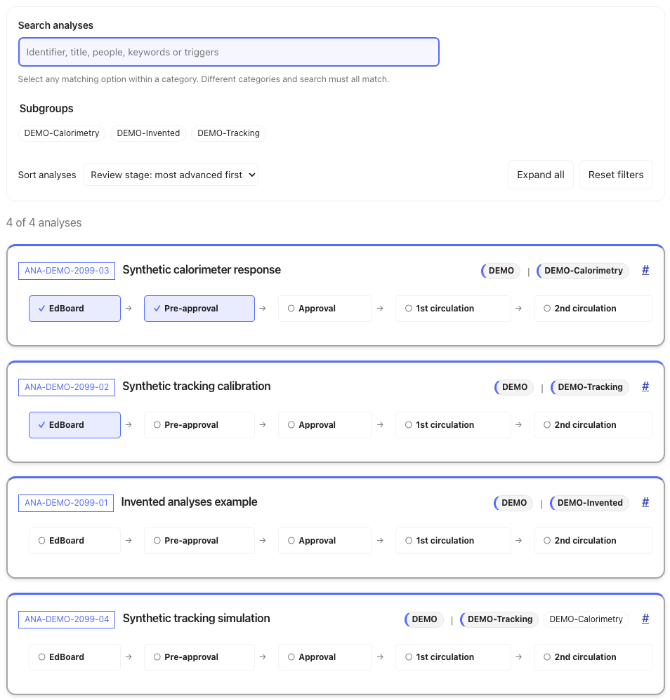
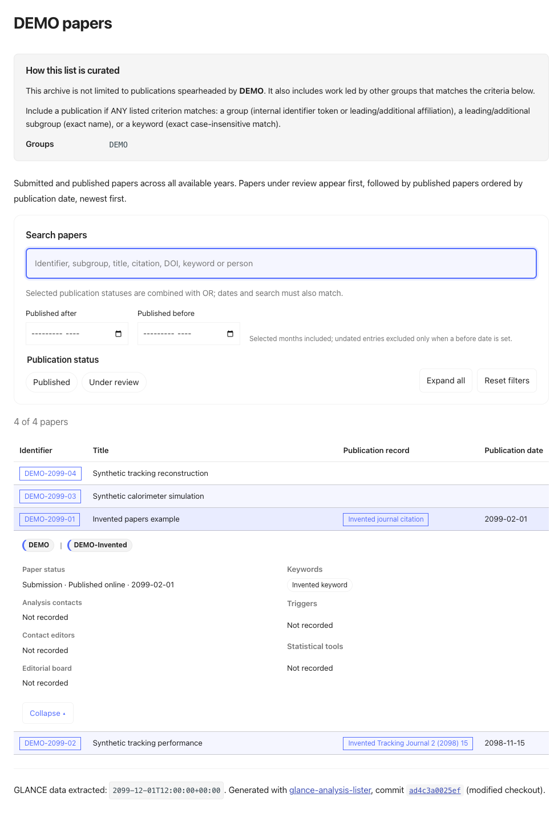

# GLANCE analysis lister

GLANCE is the system the ATLAS experiment at CERN uses to track analyses,
papers, conference notes and public notes. **GLANCE analysis lister turns those
individual records into a searchable overview of a group's work.** This Python
package retrieves and curates GLANCE data, then generates pages that bring
ongoing analyses, review progress and publication history together, with filters
and expandable details to help readers find what matters.

Use it to prepare coordination meetings, follow analysis reviews, find relevant
publications or maintain an overview on your group's internal website. Physics
and performance groups can choose which records to include and display the
results in a Markdown or Zensical site. Try the included demonstrator without
credentials, then add your group's real data with authorised CERN access.

[Try the demo](#install-and-try-without-credentials) · [Documentation](docs/README.md)

<!-- Once GitHub Pages is published, point Documentation above to
https://knutzk.github.io/glance-analysis-lister/docs/ -->

## Explore the pages

<table class="gal-screenshot-gallery" role="presentation">
  <tr>
    <td width="50%" valign="top">
      <p><strong>Ongoing analyses</strong></p>
      <a href="docs/images/ongoing.png"></a>
      <p>Searchable analysis cards with affiliations and review progress. All cards are collapsed in this screenshot; each can be expanded to show details.</p>
    </td>
    <td width="50%" valign="top">
      <p><strong>Publications</strong></p>
      <a href="docs/images/papers.png"></a>
      <p>Tables for papers, conference notes and public notes, with date filters and expandable details.</p>
    </td>
  </tr>
</table>

These screenshots show **fictional example records** rendered in a Zensical site.
Select a screenshot to open it at full size.

## Install and try without credentials

Use Python 3.13 and Git in a macOS or Linux shell. These commands install the
package and Zensical, generate fictional records and start a local website.
Installation needs internet access; the demo itself needs no CERN account.

```bash
# Get the project
git clone https://github.com/knutzk/glance-analysis-lister.git
cd glance-analysis-lister

# Create an environment and install the package with Zensical
python3.13 -m venv .venv
source .venv/bin/activate
python -m pip install -r requirements-docs.txt

# Create editable demo configuration and policy copies
mkdir -p examples/demo/work
cp examples/demo/zensical.toml examples/demo/work/zensical.toml
cp examples/demo/publication-curation.toml examples/demo/work/demo-policy.toml

# Generate pages from the synthetic records
analysis-lister render-group --group DEMO --group-title "Synthetic demo" \
  --snapshot examples/synthetic_registry.json \
  --curation-config examples/demo/work/demo-policy.toml \
  --output-dir examples/demo/work/pages

# Add the landing page and stylesheet
cp examples/demo/index.md examples/demo/work/pages/index.md
cp docs/stylesheets/site.css examples/demo/work/pages/assets/site.css

# Start the local preview
python -m zensical serve -f examples/demo/work/zensical.toml --dev-addr 127.0.0.1:8001
```

Open this address in your browser:

```text
http://127.0.0.1:8001/
```

Suggestions for exploring the demo:

- Select **Ongoing analyses**, search for `Tracking` and expand a card.
- Open **Papers** and try the publication filters.

Stop the server with **Ctrl+C** when you are finished.

## Go further

[Documentation overview](docs/README.md)

Explore page controls, configuration, troubleshooting and the Python interface,
or continue with one of these guides:

- [Reopen or build the demo](examples/README.md#reopen-or-build-the-demo): reuse your setup while keeping configuration and policy edits.
- [Add CERN data to the same demo](docs/cern-demo.md): show your group's real pages alongside the synthetic examples.
- [Change publication selection](examples/README.md#tutorial-change-publication-selection): edit a policy and see the results in the running site.
- [Integrate the pages into your website](docs/rendering.md#integrate-into-a-consuming-site): use the generated Markdown and browser assets in a group site.
- [Understand the command workflow](docs/workflows.md#how-the-commands-connect): download once, curate and render offline, or combine the stages with `refresh`.

## About the project

GLANCE analysis lister grew out of the need for a clear, regularly updated
overview of ongoing analyses and recent publications during TOPQ subgroup
coordination. Bringing the relevant GLANCE records together in one website
made it easier to follow the group's work and prepare discussions.

The resulting pages proved useful beyond the original subgroup and were adopted
on the internal TOPQ group website. The project has since become a general
package for ATLAS physics and performance groups, with configurable group
selection and publication policies for Markdown and Zensical websites.

See [compatibility](docs/compatibility.md) for the defined interface scope and
change policy, and [upgrading](docs/upgrading.md) before replacing a working
installation. To contribute, see [development and validation](docs/development.md).

Parts of this codebase were developed with AI assistance from Codex (OpenAI)
and Claude (Anthropic). All output was reviewed and validated by the author.

Copyright © 2024–2026 Knut Zoch. Licensed under
[GNU GPL version 3](LICENCE), `GPL-3.0-only`.

Maintainer: [Knut Zoch](https://github.com/knutzk).
