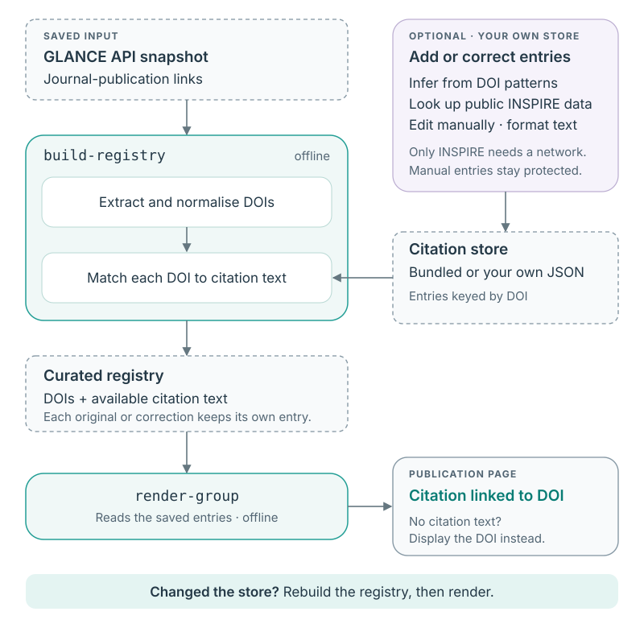

# Citations and journal references

[Documentation overview](README.md)

Publication pages use journal references to help readers identify a paper and
follow its DOI link. A reference such as `JHEP 07 (2099) 999` is more readable than
the DOI alone. A paper can also have errata or addenda, each with its own DOI and
citation. The package keeps these entries together without confusing a
correction with the original publication.

Citation information comes from two inputs: the publication links recorded in
GLANCE and a separate **citation store** containing journal-reference text and
its source. The package includes a store, so ordinary registry builds need no
citation setup. You can maintain your own copy to fill gaps or correct entries.

## How citations reach the pages

[](images/citation-flow.svg)

For citation handling, the package reads GLANCE's final journal-publication URLs
from the saved API snapshot. It extracts and normalises DOIs from DOI resolver
links or publisher URLs containing a DOI. Link labels are not used as citation
text or as DOI values; publisher identifiers such as ScienceDirect PIIs are not
converted to DOIs.

During registry construction, each DOI is matched against the selected citation
store. The resulting DOI, link and available citation text are saved together in
the curated registry. When rendering a publication page, the package uses that
saved text as the link label. If the citation is missing, it displays the DOI
instead. Citation text and DOI strings are also searchable on the paper page.

**Building and rendering do not look up citations online.** Updating the store
is a separate operation. After a correction, rebuild the registry from the saved
API snapshot using the updated store, then regenerate the pages. Rendering an
old registry again will still use its old citations.

The citation store supplies publication metadata. It does not choose which
publications belong on a group's pages; that is the role of the publication
policy and lifecycle rules.

## Files and user controls

| File | Role | When it changes |
| --- | --- | --- |
| `glance_api_registry.json` | Saved GLANCE records, including journal-publication links. | A download replaces it; citation commands leave it unchanged. |
| `json/doi_metadata.json` | Bundled citation store in a source checkout; installed builds locate the packaged copy automatically. | Updated with the package, or deliberately maintained in the checkout. |
| Your own store, for example `data/doi-metadata.json` | Citation text, source information and optional publication/correction labels keyed by DOI. | You edit it or run citation resolution/formatting commands. |
| `glance_curated_registry.json` | Curated records containing the DOI/citation entries used by rendering. | Rebuild it to apply changes to the citation store. |
| Generated `papers.md` | Publication rows with the saved citation text and DOI links. | Regenerate it from the updated registry. |

`build-registry` and the build stage of `refresh` read bundled citations by
default, regardless of the working directory. To use your maintained store,
pass `--doi-cache PATH`. An explicit path selects **only that file**: a missing
file starts empty, even if named `json/doi_metadata.json`. There is no automatic
merge with bundled entries. Stores are loaded for each operation, not on import.

The commands that update citations, `resolve-dois` and `format-citations`, always
require an explicit writable `--doi-cache PATH`. There is no implicit write
destination or per-user cache.

## Choose a store

If the bundled citations meet your needs, continue using the normal build and
render commands. To maintain additions or corrections, keep a writable store
outside the package installation so your edits survive upgrades.

To start with the bundled entries, run this from a matching source checkout or
unpacked source archive:

```bash
mkdir -p data
cp json/doi_metadata.json data/doi-metadata.json
```

Copy once when setting up a new store. If you already maintain one, use its path
instead; copying again would replace your edits. You can also start empty by
choosing a new path when resolving citations. That store will contain only the
entries you add or resolve.

Keep a backup. Upgrading the package does not migrate your store or merge newer
bundled entries into it. Maintainers can deliberately update the tracked store
with `--doi-cache json/doi_metadata.json` from a checkout and review the public
metadata changes before committing them. Installed shared data is not a durable
location for user edits.

## Add or correct a citation manually

Use a manual entry when you know the correct citation or want to preserve a
particular wording. Edit the entry for that DOI in your store and set its
`source` to `manual`. Automatic resolution and formatting leave manual entries
unchanged, including when `--refresh-existing` is used. There is no separate
lock setting.

### DOI metadata JSON

The store is a JSON object keyed by normalised, lowercase DOIs. This example
contains two independently invented entries; add or edit individual entries in
your existing store rather than replacing the whole file:

```json
{
  "10.1007/jhep07(2099)999": {
    "citation": "JHEP 07 (2099) 999",
    "source": "doi-pattern:jhep",
    "resolved_at": "2099-03-01T12:00:00+00:00"
  },
  "10.9999/synthetic": {
    "citation": "Invented journal citation",
    "source": "manual",
    "material": "publication"
  }
}
```

Each structured entry requires `citation` and `source`. Optional fields are
`material`, `resolved_at`, `source_url` and `inspire_id`. Material can identify a
`publication`, `erratum`, `addendum` or `editorial note`; omit it when unknown.
The first entry above records an inferred citation and its resolution time. The
second records a protected manual citation for an original publication. Legacy
string-only entries are also read as manual citations.

Changing a citation does not change the source DOI. Use the DOI recorded in the
snapshot as the key so registry construction can match your entry.

## Resolve citations

Resolution fills missing entries from DOI patterns or public INSPIRE metadata.
Choose the method according to the information you need and whether you want a
network request:

| Method | Behaviour |
| --- | --- |
| `infer` | Offline: recognises fully specified JHEP citations encoded in a DOI. This is the default. |
| `inspire` | Queries public INSPIRE metadata. |
| `auto` | Tries inference first, then INSPIRE if inference cannot supply a citation. It can make network requests. |

For example, fill recognised JHEP entries from a saved snapshot without network
access:

```bash
grove resolve-dois --snapshot glance_api_registry.json \
  --method infer --doi-cache data/doi-metadata.json
```

To look up remaining entries in public INSPIRE metadata instead:

```bash
grove resolve-dois --snapshot glance_api_registry.json \
  --method inspire --doi-cache data/doi-metadata.json
```

`--snapshot` accepts either a saved **API snapshot** or **curated registry**. API
snapshots supply the source journal-publication URLs; curated registries supply
the retained `publicationPhase.grove_dois[].doi` values. For the latter, use
`--snapshot glance_curated_registry.json` with the same options above. The file's
format selects the field to read: the resolver does not guess DOIs from citation
text or fall back to other fields. Malformed individual DOI values are skipped
with a warning while valid values are processed. Existing entries are skipped
by default; `--refresh-existing` revisits non-manual entries, and `--limit 10`
limits attempts.

INSPIRE requests use a separate session without GLANCE credentials, with verified
TLS, bounded retries and rate limiting. Ambiguous associations remain unresolved
and can be retried. Each successful result is saved atomically to the selected
store; resolution does not rewrite the input snapshot.

## Format citations and update pages

After editing or resolving entries, you can normalise supported journal names
and starting-page notation offline. Formatting leaves manual entries unchanged
and writes the store only if an entry changes.

The following sequence applies your store to a saved API snapshot and regenerates
the pages. TOPQ and the output directory are examples; use your own group and
existing render destination. Run from the directory containing the snapshot,
using the same store path throughout:

```bash
# Normalise automatically generated citations
grove format-citations --doi-cache data/doi-metadata.json

# Embed the updated citations in the curated registry
grove build-registry --api-snapshot glance_api_registry.json \
  --doi-cache data/doi-metadata.json --output glance_curated_registry.json

# Regenerate the pages from that registry
grove render-group --group TOPQ \
  --snapshot glance_curated_registry.json --output-dir examples/demo/work/pages/topq
```

The formatter is optional; the rebuild and render are necessary to apply store
changes to the pages. If your group uses a custom publication policy, pass its
`--curation-config PATH` to `render-group` as usual. Run commands writing the same
store or output files sequentially. The standalone demo reloads regenerated
pages; an existing website needs its normal build/publication step afterwards.

## Original papers and corrections

A paper's final journal links may include an original article and its
corrections. Each extracted DOI keeps its own citation. Store entries can use
`material` labels to distinguish the original from an erratum, addendum or
editorial note.

When exactly one entry is labelled `publication` and every other entry is a
known correction, the original is placed first. Corrections use DOI-encoded
dates when those establish an order; otherwise their relative input order is
retained. Without sufficient material labels, the package uses DOI-encoded dates
where they establish an order. Unknown or overlapping dates leave the input
order unchanged and produce an ambiguity warning when several DOIs are present.
Inspect the metadata rather than guessing which link is the original.

## Example: infer a citation without a network request

This invented DOI lets you try resolution without a GLANCE snapshot. Use a
separate temporary store to leave your maintained and bundled stores untouched:

```bash
grove resolve-dois --doi '10.1007/JHEP07(2099)999' \
  --method infer --doi-cache /tmp/demo-citations.json
```

The stored citation is `JHEP 07 (2099) 999`, with source `doi-pattern:jhep`.
Inference formats a recognised pattern; it does not verify that a publication
exists. This DOI and citation are fictional. The command only updates the store;
it does not add a paper to a registry or change any generated page.

For options, see the [citation command reference](cli-reference.md#resolve-dois).
If a change does not appear, check the store path, rebuild and render sequence in
[troubleshooting](problems.md#citation-updates-do-not-reach-the-pages).
