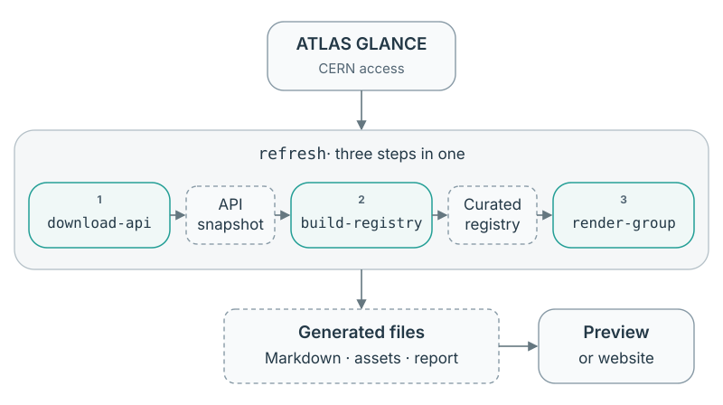

# GLANCE data and the curated registry

[Documentation overview](README.md)

GLANCE records analyses, papers and notes as separate resources with their own
identifiers, statuses, dates and links. The package saves those records locally
so you can prepare group pages without contacting CERN every time.

Two saved files serve different purposes. The **API snapshot** preserves the
retrieved records; the **curated registry** keeps the fields the package uses,
normalises selected metadata and adds public identifiers and citation text.
Keep the API snapshot when you want to rebuild with newer curation rules or
updated dictionaries. The curated registry is not a lossless archive.

Group selection happens after curation. Downloading a snapshot does not select
TOPQ or any other group; the same saved data can supply several groups' pages.
For a first run, use the CERN demo guide. This page explains the inputs and how
to maintain them.

## The files you maintain

| Input or output | What it contains | What you control |
| --- | --- | --- |
| API snapshot | Accessible GLANCE records and download metadata. | When to download and where to save it. |
| Curated registry | Adopted fields, explicit relationships and enrichment from the API snapshot. | When to rebuild and which citation store to use. |
| Citation store | DOI-keyed journal references and source information. | Bundled defaults or your own maintained store; see the citations guide. |
| Public-note identifier dictionary | Public CDS-to-PUB associations used when the API lacks a usable final identifier. | Bundled package data; no public CLI override or live CDS lookup. |
| Publication policy | Selection criteria for a group's publications. | Applied when preparing pages, not when constructing the registry. |

[CERN walkthrough](cern-demo.md) · [Citations](citations.md) · [Group selection](selection.md)

## How the commands connect

The three numbered boxes are `analysis-lister` commands. **`refresh` runs steps
1–3 in order**; previewing the result is a separate step.



The default filenames connect the stages: `download-api` writes
`glance_api_registry.json`; `build-registry` reads it and writes
`glance_curated_registry.json`; `render-group` reads that registry. Only the
download needs CERN access. From a saved snapshot, rebuild after curation changes
or render again after changing the group or publication policy.

For a guided first run, [add CERN data to the standalone demo](cern-demo.md).
The workflows below also support existing consuming websites and explicit paths.

## What curation changes

Curation retains independent records and their explicit relationships while
selecting the fields defined by the curated-data contract. Named collections
such as keywords become lists of names; added or reshaped fields use the `gal_`
prefix. Original keys replaced by these fields are removed. New API fields are
not adopted automatically, and DOI/citation entries remain paired with their
original publication or correction.

The registry is validated before it replaces the saved output. The bundled
schema checks nested types and dates; additional checks enforce counts and
unique identifiers. Unknown or contradictory source evidence is retained where
the contract provides for it, not silently repaired. Only curated v2 is supported.

[Data contract](curated-format.md) · [Extending curation](contributing-field.md)

### Example: keywords before and after curation

An invented API record can contain this metadata fragment:

```json
{
  "metadata": {
    "keywords": [
      {"name": "Invented keyword"},
      {"name": "Second keyword"}
    ]
  }
}
```

The corresponding curated fragment is:

```json
{
  "metadata": {
    "gal_keywords": ["Invented keyword", "Second keyword"]
  }
}
```

The named objects become strings under a `gal_` field. The original `keywords`
field is removed during field selection, and the view uses `gal_keywords` for
search. These are fragments, not complete registries; the
[curated contract](curated-format.md) defines the required container fields.

### Relationships between records

An analysis and its publications remain separate records. Analyses and papers
use `referenceCode`; notes use `temporaryReferenceCode`. A final public note
number is a display identifier, not a replacement for native identity. Equal
titles or similar identifiers do not establish a relationship.
The [data contract](curated-format.md) defines retained fields and preserves
the distinction between missing, null and empty values.

Preparation follows explicit links in both directions. A publication's
`relatedAnalysis` establishes its analysis association. An analysis-only
outbound link can supply linked-publication context, with an informational
diagnostic. If the publication points to a different analysis, preparation
reports the conflict rather than assigning it to both. A missing target remains
unresolved; it is not fabricated or silently matched by title.

Publications can appear without a resolved analysis link when their own policy
and lifecycle evidence qualifies them. Missing affiliations or search metadata
may use the publication's explicit analysis link, with the derivation recorded.
People remain those recorded on each resource in the current snapshot; they
are not reconstructed as historical membership. See the
[missing-link example](problems.md#example-a-missing-link-does-not-exclude-a-published-paper)
for the effect on a rendered paper.

### Public links and note identifiers

For published or arXiv-submitted papers, public-page URLs are constructed from
native reference codes. These canonical URLs are marked as derived; the package
does not check page availability.

For notes, a valid API final identifier takes precedence. Otherwise, CONF/PUB
numbers are extracted from API public-page URLs when unambiguous. PUB notes
linked to the CERN Document Server (CDS) can use the bundled
`json/pubnote_identifiers.json` mapping from public CDS record numbers to PUB
identifiers and canonical CDS URLs.

That dictionary preserves public associations from an existing GLANCE export,
including historical detector and technical PUB-note series. It contains no
private analysis identifiers, titles or people. There is no runtime updater or
CDS request.

Release evidence without an identifier produces a diagnostic, not a guessed
number. Derivations are recorded in `gal_publicationProvenance`; curated metadata
records the dictionary hash and source counts.

## Choose where to start

Reuse the earliest saved input needed for your change. Only downloading fresh
GLANCE records requires CERN access; rendering never refreshes the snapshot.

| What changed or needs doing | Start here | Then |
| --- | --- | --- |
| Get current GLANCE records and update group pages | [Refresh](website.md#refresh-group-pages-in-one-command) | Inspect the report and integrate the pages into your site. |
| Rebuild after a curation-code or identifier-dictionary update | [Build from a saved API snapshot](#download-and-build-a-registry) | Render the resulting curated registry. |
| Update citations | [Maintain the citation store](citations.md) | Build with that store, then render. Only INSPIRE lookup needs public network access. |
| Change group, publication policy, titles or renderer | [Render a saved curated registry](website.md#reuse-a-snapshot-offline) | Inspect the new pages and report. |
| Understand changes between saved snapshots | [Compare snapshots](#compare-saved-snapshots) | Review the summary and, if needed, the detailed report. |
| Inspect your group alongside the synthetic demo | [Local group preview](documentation.md#preview-your-group-alongside-demo) | Render to `pages/topq`, then explicitly select it in the local documentation preview. |
| Add generated pages to an existing site | [Stage pages and enable assets](website.md#integrate-into-a-consuming-site) | Build and preview the consuming site. |

## Download and build a registry

After [installation](../README.md#install-and-try-without-credentials), use
`analysis-lister` or `python -m analysis_lister`. Live GLANCE downloads require
an authorised CERN account. Run data commands from the directory where you
want to keep the snapshots, or supply explicit paths. Use
`analysis-lister COMMAND --help` for the options supported by your installation.

The [command flowchart](#how-the-commands-connect) shows how the saved
files connect the stages. To produce TOPQ pages without `refresh`, execute
these three commands **in order**, from the same directory:

```bash
analysis-lister download-api --login
analysis-lister build-registry
analysis-lister render-group --group TOPQ --output-dir pages/topq
```

The download retrieves all accessible records, including their explicit
relationships. Group and subgroup selection happens later, when preparing views.
Building the registry needs only the saved API JSON and identifier/citation
dictionaries; it makes no network requests.
`build-registry` reads `glance_api_registry.json` and writes
`glance_curated_registry.json`. `render-group` reads the latter and writes the
four Markdown pages, browser assets and report into `pages/topq/`.
Then [preview the pages alongside Demo](documentation.md#preview-your-group-alongside-demo)
or integrate them into your consuming site. Neither rendering nor previewing
downloads fresh records.

Default snapshot and dictionary locations are listed in the
[reference](cli-reference.md#paths-and-shared-options).

To choose snapshot destinations:

```bash
analysis-lister download-api --output data/api.json
analysis-lister build-registry \
  --api-snapshot data/api.json \
  --output data/curated.json
analysis-lister render-group --group TOPQ \
  --snapshot data/curated.json --output-dir pages/topq
```

Keep real snapshots and diagnostic reports out of version control. Add these
entries to the consuming repository's `.gitignore`:

```gitignore
/glance_api_registry.json
/glance_curated_registry.json
**/view-report.json
```

Add any custom destinations too. Publish generated Markdown and assets only when
the records they expose are suitable for the intended audience.

### Where the other commands fit

These are separate tools; `refresh` does not run them.

| Command | Role in the workflow |
| --- | --- |
| `download-html` | Independent GLANCE HTML-to-CSV export. Its CSV files are not inputs to `build-registry`. |
| `compare-snapshots` | Compares two saved API snapshots or two curated registries; does not render or update pages. |
| `resolve-dois` | Infers citation text offline or retrieves metadata from INSPIRE into an explicitly selected writable cache. Use that cache with `build-registry --doi-cache PATH`. |
| `format-citations` | Formats entries in the selected citation cache. Rebuild the registry with that cache, then render to update displayed citations. |

See [citation maintenance](citations.md) and the
[command-line reference](cli-reference.md) for options and prerequisites.

### API pagination

`download-api --page-size 250` requests 250 records per page. Any positive integer
is accepted locally, subject to server support; the default of 500 is not a
known server maximum. Requests run sequentially through one stare client, with
response caching disabled. Speed depends on the server and network.

Pages request ascending native-identifier order: `referenceCode` for analyses
and papers, `temporaryReferenceCode` for notes. These are stare model aliases;
its [sorting documentation](https://github.com/kratsg/stare/blob/d47df314e4e4bb00e34d00b1f8cbe3ce85bdf22c/docs/examples.md)
accepts camelCase API fields. The snapshot records the requested sort and page size.

Records can change between requests, so this is not a transactional snapshot.
Duplicate detection, consistent totals, count-drop checks and atomic publication
protect the output. Offline tests exercise the stare client and serializers;
live server limits, sorting behaviour and speed need separate validation.

### Build summaries

`build-registry` reports retained/discarded field counts per resource and
input/output file sizes with their percentage change. Field counts measure
nested object keys after enrichment, including original and derived fields.
They do not measure lost information; all records are retained. Byte sizes
include JSON formatting and build metadata.

## Compare saved snapshots

Save the previous snapshot under a separate filename before replacing it, then
compare the two files:

```bash
analysis-lister compare-snapshots previous.json glance_curated_registry.json --details \
  --output snapshot-comparison.json
```

Both inputs must be API snapshots or both must be curated registries, from the
same endpoint. Records are matched by native identifier regardless of file order.
The summary counts added, removed, changed and unchanged records per resource.
`--details` lists affected identifiers and field paths. The optional JSON report
also contains before/after values and file hashes; keep it private with the inputs.

Comparison includes statuses, affiliations, DOIs, relationships and missing
fields. It ignores container timestamps, build metadata and dictionary order.
List order matters, including DOI and correction order; missing fields differ
from explicit `null` values.

A curation-code or dictionary change can alter a curated record without a GLANCE
edit. Compare API snapshots to isolate upstream changes. Neither input is
modified. A valid comparison exits with status zero even when it finds changes;
invalid snapshots or incompatible formats fail.

## Trace your output

Generated files identify the registry, configuration and generator that produced
them. These fingerprints help distinguish a GLANCE change from a change to
citation data, curation rules or publication selection. They record differences;
a changed hash does not by itself indicate an error.

The exact headers and hash fields are documented in the output reference.

[Output fingerprints](output-reference.md#generated-headers)

### Reproducible output

The same snapshot bytes and basename, effective profile, generator contents and
revision, and runtime produce byte-identical pages, assets and reports. Tests
cover separate processes, Python hash seeds, time zones and output locations.

Unchanged files are not rewritten, preserving timestamps and inodes. Missing or
modified generated files are replaced; unrelated files remain untouched. The
log reports written/unchanged counts. These counts are excluded from the report
because they depend on the existing output directory.

### Example: which changes affect the result?

Suppose you render the same DEMO snapshot twice, then edit the publication policy:

| Change | Expected result |
| --- | --- |
| Render again with identical inputs, configuration and generator | Generated bytes and file timestamps remain unchanged. |
| Add a comment to the policy TOML | The effective profile hash stays the same. |
| Edit an unrelated group's policy | The DEMO profile hash stays the same. |
| Change the DEMO publication title | The profile hash changes, along with the publication headings. |
| Change a record in the snapshot | The snapshot hash changes, even if that field is not displayed. |

Use these hashes to identify which input changed before comparing the rendered
text. A different hash records a difference; it does not by itself indicate an
error.

## Separate HTML and CSV exports

From a checkout, install the HTML dependencies and start the export:

```bash
python -m pip install '.[html]'
analysis-lister download-html --login
```

Chrome opens for manual CERN SSO. Later runs reuse `cookies.json`. The command
exports all available columns from the analyses, papers, CONF-note and PUB-note
tables to the calling directory. Use `--csv-dir DIR` for another destination.
These CSVs are standalone exports; `build-registry` does not read them.

TLS verification remains enabled and supports `REQUESTS_CA_BUNDLE`. Table counts
and identifiers are checked before all four files are published as a batch.
Duplicate or unnamed non-identifier headers receive unique names; every column
and its original position are retained. `download-html --help` describes how to
save HTML and replay it offline.

Keep cookies and exports private. Ignore `cookies.json`, the four CSVs,
`html_manifest.json`, `.html-download-in-progress`, `.refresh-*/` and any directory
selected with `--save-html`.
