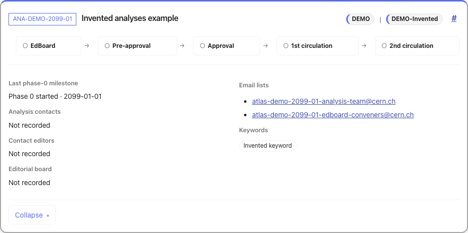

# Ongoing analyses

[Documentation overview](README.md)

The ongoing page shows analysis cards with review progress, affiliations and
expandable details. Start with the example below, then use the selection and
filtering rules to interpret your own pages.

## Read an analysis card

This screenshot shows a card generated from the [synthetic example](../examples/README.md).
In a generated page, click its title to open the details. All identifiers, email addresses and metadata are invented;
the external links do not identify real records.



| Part of the card | What the example shows |
| --- | --- |
| Identifier and title | `ANA-DEMO-2099-01`, “Invented analyses example”. The identifier opens GLANCE; the title expands the details. |
| Affiliations | `DEMO` and `DEMO-Invented` identify the recorded group and subgroup. |
| Milestones | The review steps have no completion ticks because those dates are absent from the fixture. |
| Details | Phase 0 started on 1 January 2099. People are shown as **Not recorded**; the keyword is **Invented keyword**. |
| Permalink | The `#` link opens this card even when filters would otherwise hide it. |

## Which records appear

Ongoing selection uses leading or additional main-group affiliation, independently
of publication policy. Each analysis appears once. Closed and completed analyses
are excluded; uncertain records are listed separately.

An analysis that has finished phase 0 remains ongoing if its linked publication
is marked Created, with the label “Awaiting publication review”. Papers that
have finished phase 1 or phase 2 stay in publication review until submission or
publication is established. Unresolved linked-publication states still need review.

## Search and sort

In [generated group pages](rendering.md), search covers identifiers,
titles, people, keywords, triggers and statistical tools. Subgroup buttons use
recorded names in the group's namespace and appear only when they have matching
ongoing analyses. Review-stage sorting follows the displayed milestone ticks.
**Expand all** opens the cards; **Reset** clears filters and restores the default
sort. Each card has a permalink that reveals and opens it.

## Share a filtered view

The `q` URL parameter stores search text. Repeated `subgroup` values are combined
with OR; `sort` accepts `reference`, `stage-desc` or `stage-asc`:

```text
ongoing/?q=example&subgroup=DEMO-First&subgroup=DEMO-Second&sort=stage-desc
```

This selects either subgroup, searches for “example”, and puts the most advanced
review stages first. The default sort is omitted from the URL. Opening, reloading
or navigating back to a link restores its controls. URL updates preserve unrelated
parameters and card anchors.
