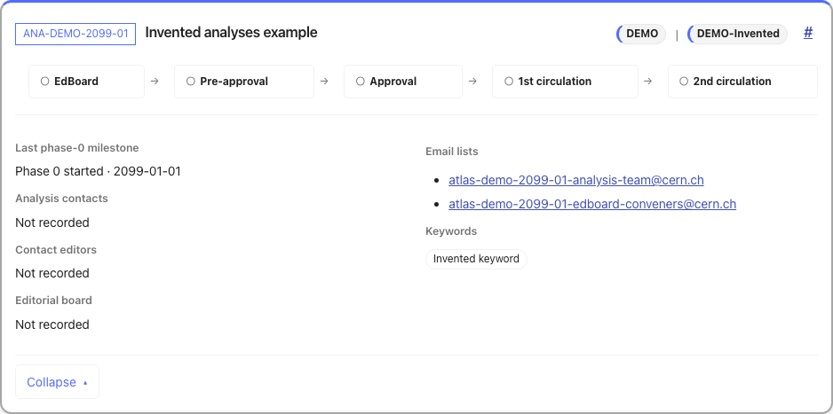
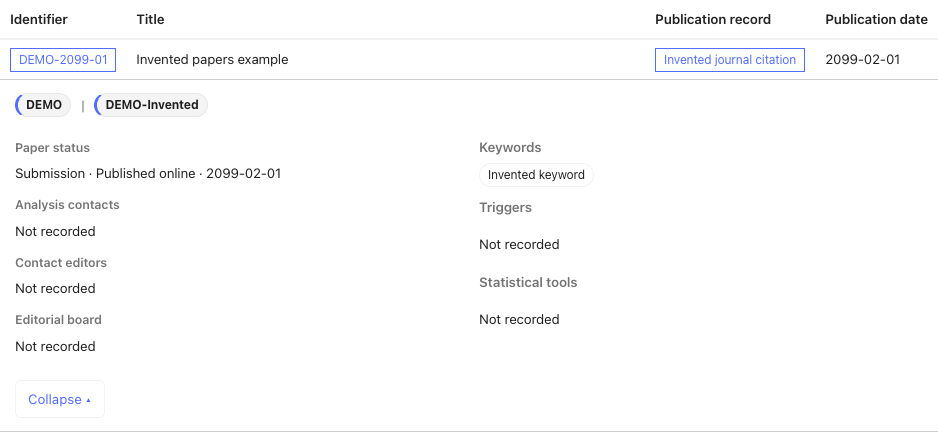

# Exploring the generated pages

[Documentation overview](README.md)

A generated group site has an ongoing-analysis page and three publication pages:
papers, conference notes and public notes. Use the cards to follow work in
progress and the tables to browse the publication archive. All controls operate
on the generated data; searching does not contact GLANCE.

The examples below use invented records and the same renderer as your group's
pages. Expand them to explore their details. For full search and filtering,
open the Demo section in the navigation.

## Ongoing analyses

The ongoing page shows analysis cards with review progress, affiliations and
expandable details. Start with the example below, then use the selection and
filtering rules to interpret your own pages.

### Read an analysis card

This is a working card generated from the [synthetic example](../examples/README.md).
Click its title to open the details. All identifiers, email addresses and metadata are invented;
the external links do not identify real records.

<!-- BEGIN LIVE ongoing -->

<!-- END LIVE ongoing -->

| Part of the card | What the example shows |
| --- | --- |
| Identifier and title | `ANA-DEMO-2099-01`, “Invented analyses example”. The identifier opens GLANCE; the title expands the details. |
| Affiliations | `DEMO` and `DEMO-Invented` identify the recorded group and subgroup. |
| Milestones | The review steps have no completion ticks because those dates are absent from the fixture. |
| Details | Phase 0 started on 1 January 2099. People are shown as **Not recorded**; the keyword is **Invented keyword**. |
| Permalink | The `#` link opens this card even when filters would otherwise hide it. |

### Search and sort analyses

In [generated group pages](website.md), search covers identifiers,
titles, people, keywords, triggers and statistical tools. Subgroup buttons use
recorded names in the group's namespace and appear only when they have matching
ongoing analyses. Review-stage sorting follows the displayed milestone ticks.
**Expand all** opens the cards; **Reset** clears filters and restores the default
sort. Each card has a permalink that reveals and opens it.

### Share an analysis view

The `q` URL parameter stores search text. Repeated `subgroup` values are combined
with OR; `sort` accepts `reference`, `stage-desc` or `stage-asc`:

```text
ongoing/?q=example&subgroup=DEMO-First&subgroup=DEMO-Second&sort=stage-desc
```

This selects either subgroup, searches for “example”, and puts the most advanced
review stages first. The default sort is omitted from the URL. Opening, reloading
or navigating back to a link restores its controls. URL updates preserve unrelated
parameters and card anchors.

## Publication tables

Papers, conference notes (CONF) and public notes (PUB) each have a table with one
row per publication and no pagination. Expand a row to see affiliations, people,
metadata and supporting links. **Expand all** and **Collapse all** affect visible
results.

| Page | Links and dates | Status controls |
| --- | --- | --- |
| Papers | GLANCE, arXiv, citations/DOIs and publication dates | **Published** (has a DOI) and **Under review** (no DOI). |
| CONF/PUB notes | Public identifiers, GLANCE, CERN Document Server (CDS) links and release dates | Non-superseded and superseded notes; defaults to non-superseded. Explicit superseding records are linked in the details. |

All publication pages search identifiers, subgroups, titles, citations, keywords
and people. Paper search also includes DOI strings; note search includes CDS URLs.

**After** and **Before** select inclusive year-and-month bounds on publication or
release dates. Undated entries remain visible unless a Before bound is set.
Search, dates and status must all match; selected statuses are combined with OR.
**Reset** clears filters and restores the default status selection.

### Read a publication row

This paper is one of four in the [synthetic fixture](../examples/README.md). Click its title
to reveal its details. This is the
same table renderer used in generated group pages.

<!-- BEGIN LIVE publications -->

<!-- END LIVE publications -->

`DEMO-2099-01` has an invented DOI and an online publication date of 1 February
2099. It appears under **Published**, because that filter checks for a DOI.
The citation links to that DOI; it is example metadata, not a real publication.

On a generated publication page, filters affect this paper as follows:

| Filter | Result for this paper |
| --- | --- |
| Search `Invented keyword` | Visible: search includes expanded metadata. |
| After `2099-02`, Before `2099-02` | Visible: the month bounds are inclusive. |
| Before `2099-01` | Hidden: publication is in February. |
| Select only **Under review** | Hidden: the paper has a DOI. |

### Share a publication view

Publication URLs store search in `q`, date bounds in `after` and `before`, paper
status in `status`, and note status in `supersession`:

```text
papers/?q=Invented&after=2099-02&before=2099-02&status=published
```

This selects published papers matching “Invented” in February 2099. Controls are
restored when opening or reloading a link and when navigating browser history.
URL updates preserve unrelated parameters and record anchors.

[Generate a website](website.md) · [Choose which records appear](selection.md)

## Understand a missing record

First reset the browser filters. Superseded notes are hidden by default, and an
undated publication does not pass a Before date bound. A record still missing
may have been excluded by group membership, publication policy or lifecycle
rules before rendering. The diagnostic report explains those decisions.

[Selection rules](selection.md) · [Warnings and recovery](problems.md) · [URL reference](file-reference.md#filter-parameters)
