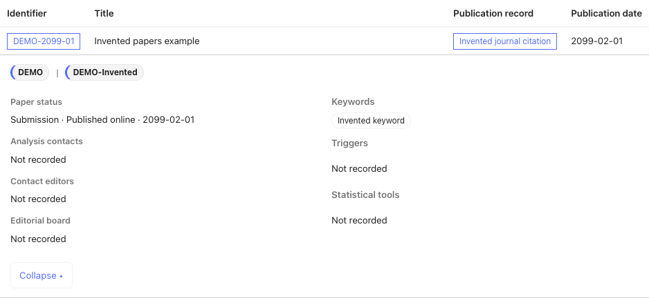

# Publication tables

[Documentation overview](README.md)

Papers, conference notes (CONF) and public notes (PUB) each have a table with one
row per publication and no pagination. Expand a row to see affiliations, people,
metadata and supporting links. **Expand all** and **Collapse all** affect visible
results.

| Page | Links and dates | Status controls |
| --- | --- | --- |
| Papers | GLANCE, arXiv, citations/DOIs and publication dates | **Published** (has a DOI) and **Under review** (no DOI). |
| CONF/PUB notes | Public identifiers, GLANCE, CERN Document Server (CDS) links and release dates | Non-superseded and superseded notes; defaults to non-superseded. Explicit superseding records are linked in the details. |

All publication pages search identifiers, subgroups, titles, citations, keywords
and people. Paper search also includes DOI strings; note search includes CDS URLs.

**After** and **Before** select inclusive year-and-month bounds on publication or
release dates. Undated entries remain visible unless a Before bound is set.
Search, dates and status must all match; selected statuses are combined with OR.
**Reset** clears filters and restores the default status selection.

## Read a publication row

This paper is one of four in the [synthetic fixture](../examples/README.md). Click its title
to reveal its details. This is the
same table renderer used in generated group pages.

<!-- BEGIN LIVE publications -->

<!-- END LIVE publications -->

`DEMO-2099-01` has an invented DOI and an online publication date of 1 February
2099. It appears under **Published**, because that filter checks for a DOI.
The citation links to that DOI; it is example metadata, not a real publication.

On a generated publication page, filters affect this paper as follows:

| Filter | Result for this paper |
| --- | --- |
| Search `Invented keyword` | Visible: search includes expanded metadata. |
| After `2099-02`, Before `2099-02` | Visible: the month bounds are inclusive. |
| Before `2099-01` | Hidden: publication is in February. |
| Select only **Under review** | Hidden: the paper has a DOI. |

## Share a filtered view

Publication URLs store search in `q`, date bounds in `after` and `before`, paper
status in `status`, and note status in `supersession`:

```text
papers/?q=Invented&after=2099-02&before=2099-02&status=published
```

This selects published papers matching “Invented” in February 2099. Controls are
restored when opening or reloading a link and when navigating browser history.
URL updates preserve unrelated parameters and record anchors.

See [rendering and policies](rendering.md) to generate these pages and select
which publications they contain.
