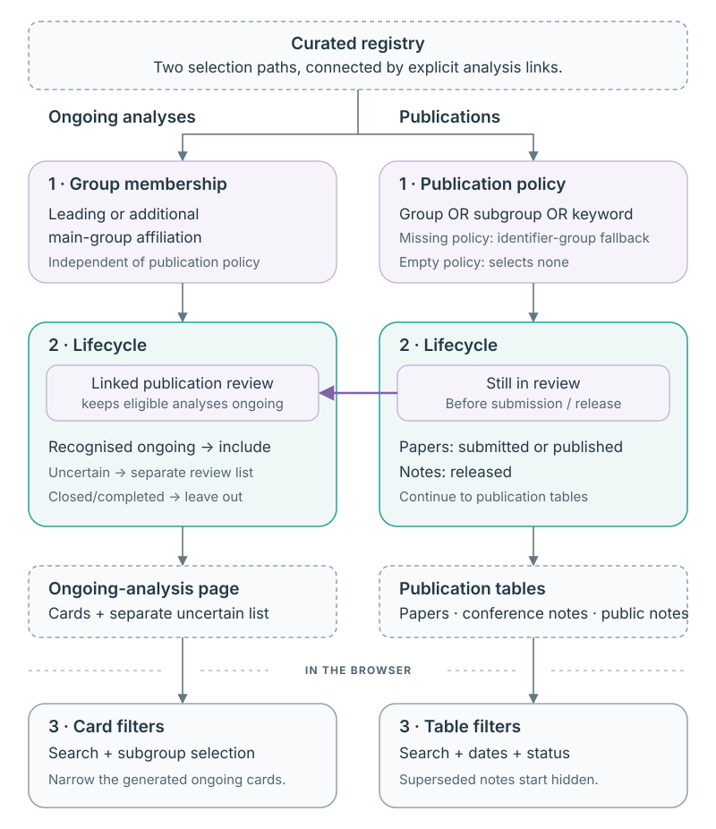

<!-- SPDX-FileCopyrightText: 2024-2026 Knut Zoch -->
<!-- SPDX-License-Identifier: GPL-3.0-only -->

# Choosing analyses and publications

[Documentation overview](README.md)

A group overview answers two different questions: which analyses are still
being worked on, and which publications belong in the group's archive. The
package answers them separately. A publication policy can include papers from
another group without adding that group's ongoing analyses.

The saved registry supplies records and relationships. When preparing a group,
the package applies membership, publication selection and lifecycle rules. The
browser then lets readers narrow the records already included. Changing a search
filter does not change the registry or the policy.

## Three decisions

[](images/selection-flow.svg)

Three decisions determine what a reader sees:

1. **Group and policy selection:** ongoing analyses use main-group affiliation;
   publications use the group's configured policy. Policy criteria combine with
   OR, with distinct behaviour for missing and explicitly empty policies. The
   [policy reference](#publication-policies) defines those rules.
2. **Lifecycle placement:** recognised ongoing analyses go on the ongoing page;
   uncertain analyses are listed separately. Publication tables contain selected
   submitted/published papers and released notes. A policy match alone does not
   establish submission or release. Linked publications inform analysis progress
   even when the publication policy excludes them from the archive.
3. **Browser filtering:** search, dates and status narrow the generated records.
   They do not change the registry, policy or diagnostic counts. Superseded
   released notes are retained in the output but hidden by the default filter.

For example, a submitted paper without a DOI can be included in the archive
under its **Under review** filter, while its linked analysis has completed active
review. That browser label tests for a DOI; it is not the lifecycle decision used
to determine archive eligibility. See [publication tables](pages.md#publication-tables).

Lifecycle rules use source statuses, recorded dates and explicit relationships.
Milestone ticks are evaluated independently: a later recorded step does not fill
in missing earlier dates. Unknown or contradictory evidence stays available in
the [diagnostic report](problems.md#read-the-diagnostic-report). The preparation layer records decisions;
renderers display them without reclassifying source records.

## Choose your group

`render-group --group TOPQ` chooses the main group for ongoing analyses and the
`[groups.TOPQ]` policy table for publications. TOPQ is an example: use your own
ATLAS physics or performance group token. Keep output folders and website
navigation consistent with that choice when adding several groups.

## Ongoing-analysis membership

Ongoing selection uses leading or additional main-group affiliation, independently
of publication policy. Each analysis appears once. Closed and completed analyses
are excluded; uncertain records are listed separately.

An analysis that has finished phase 0 remains ongoing if its linked publication
is marked Created, with the label “Awaiting publication review”. Papers that
have finished phase 1 or phase 2 stay in publication review until submission or
publication is established. Unresolved linked-publication states still need review.

## Control publication selection

A publication policy chooses records by group, subgroup or keyword. It is useful
when the set of publications your team follows differs from simple main-group
membership. Matching a policy makes a record a candidate; the publication's
lifecycle evidence still determines whether it is ready for the archive.

Keep a policy file outside the installed package if you want to maintain your
own criteria. Pass its path when rendering, or with `refresh`. The synthetic
policy tutorial shows the effect of changing one before using real records.

[Try a policy edit](../examples/README.md#tutorial-change-publication-selection)

### Publication policies

The bundled [`publication-curation.toml`](../publication-curation.toml) controls
publication inclusion. It is used regardless of the working directory. Edit it
to maintain shared policies, or pass `--curation-config PATH` for an alternative.
Each group has its own table:

```toml
[groups.TOPQ]
title = "Top Quark Physics"
groups = ["TOPQ"]
subgroups = []
keywords = []
```

Only a top-level `groups` table is accepted. Each `[groups.NAME]` table accepts
these fields; unknown fields or invalid types fail validation, including in
tables for other groups.

| Field | Type / default when omitted | Meaning |
| --- | --- | --- |
| `title` | Nonempty string / group display title | Publication-page title. |
| `groups` | List of nonempty strings / `[]` | Match an internal identifier's group token (case-insensitive), or an exact leading/additional main-group affiliation. |
| `subgroups` | List of nonempty strings / `[]` | Match an exact leading/additional subgroup name. A name containing a comma remains one string. |
| `keywords` | List of nonempty strings / `[]` | Match an exact label after trimming whitespace and ignoring case. |

Criteria are combined with **OR**: any match includes the publication. These
rules select publications independently of ongoing-analysis membership.

Missing publication affiliations or metadata can be supplied by an explicitly
linked analysis; the report records that derivation. No extra group criterion
is added implicitly. An explicitly empty policy selects no publications.

If a group's table is missing, the command warns on stderr and falls back to
its internal identifier's group token. Define a table even for a group that
selects only its own publications. `title` sets publication-page headings;
`--group-title` sets the ongoing-page heading and supplies the fallback when
the policy omits `title`; without either, headings use the group name. Policy
strings are trimmed, and duplicate criteria are removed when loading.

## Example: include a neighbouring group's publications

This invented policy includes DEMO publications and publications tagged with the
keyword `Shared example`. Criteria combine with OR, so either match is enough:

```toml
[groups.DEMO]
title = "Example collaboration"
groups = ["DEMO"]
subgroups = []
keywords = ["Shared example"]
```

Render with `--group DEMO --curation-config PATH` using that file. Ongoing
membership still uses DEMO's leading/additional main-group affiliations. A
matching paper that has not been submitted does not become an archived paper
merely because the keyword matches. Browser filters can hide included records,
but cannot bring an excluded publication into the generated output.

After editing the policy, rerender the saved curated registry; no download or
registry rebuild is needed. If a result surprises you, inspect the diagnostic
report to distinguish policy exclusion, lifecycle placement and missing metadata.

[Generate pages](website.md) · [Interpret warnings](problems.md) · [Use page filters](pages.md)
